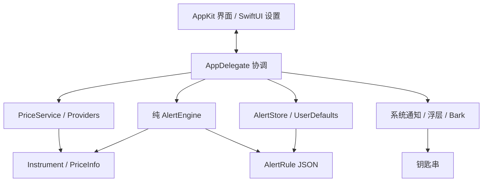

# JDGold · 阶段三：原生界面与交互

以本次上传的 `JDGold-stage2.zip` 为基线，完成菜单栏、下拉菜单、悬浮窗、SwiftUI 偏好设置与通知体验的代码改造。
最低运行 macOS 12；零第三方依赖；保留 Swift Package Manager 和 `build.sh`。

**交付状态：共享核心测试 20/20 通过，全部 Swift 源码通过语法解析，核心严格并发检查通过。当前环境没有 macOS SDK，尚未完成完整 Mac 编译、真实钥匙串/通知授权及浅深色实机验收。不要把核心测试通过写成“完整 App 已验收”。**

基于 [PiaoyangGuohai1/GoldPrice（JDGold）](https://github.com/PiaoyangGuohai1/GoldPrice) 二次开发，保留上游作者署名。上传工程没有原 LICENSE；没有生成冒充原件的文件。原许可证保留方式见 [NOTICE.md](NOTICE.md)。

## 先生成可以运行的 App

不需要完整 Xcode，需要 Command Line Tools 的 Swift 5.7 或更新版本，以及包含 ServiceManagement 的 macOS 13 或更新 SDK；**App 的最低运行系统仍是 macOS 12**。
Apple 的 SMAppService 只在 macOS 13+ 使用，macOS 12 提供手动登录项引导：
https://developer.apple.com/documentation/servicemanagement/smappservice

解压后，在终端输入 `cd `（末尾留空格），把 **JDGold-stage3 文件夹**拖进终端，按回车。先退出正在运行的旧 JDGold，再执行：

```bash
chmod +x build.sh
./build.sh
open ./JDGold.app
```

脚本在工程目录生成新的 `JDGold.app`，**不直接改应用程序里的旧版本**。
优先复用工程目录、`/Applications`、`~/Applications` 内已有的 JDGold 外壳，保留其 Info.plist、Bundle ID、图标和资源，以便找到旧偏好和钥匙串。
未找到外壳时才用随附的最小 Info.plist 创建 App；此时不会有原应用图标。

原 App 在其他位置时，明确指定外壳：

```bash
./build.sh --app-shell "/你的实际路径/JDGold.app"
```

确认规则和通知正常后，退出测试版 App，再将工程目录的新 `JDGold.app` 拖入“应用程序”替换。保留旧 App 副本，便于回退。
若终端找不到编译工具，先执行 `xcode-select --install`，完成安装后再构建。检查版本可用：

```bash
xcrun swiftc --version
xcrun --sdk macosx --show-sdk-path
```

## 只生成 Unix 可执行文件

```bash
./build.sh --binary-only
./JDGold --selftest
```

工程根目录的 **JDGold** 就是需要的 Unix 可执行文件。必须编译整个 `Sources/`，不能单独编译 `main.swift`。
退出旧 App，把新 JDGold 拖入旧 App 的 `Contents/MacOS/` 替换同名文件，然后执行：

```bash
codesign --force --deep --sign - "/Applications/JDGold.app"
codesign --verify --deep --strict "/Applications/JDGold.app"
open "/Applications/JDGold.app"
```

使用新 App 包更方便，脚本会自动处理本地签名。脚本先编译 arm64、x86_64，再合并；只有一个架构成功时保留可用产物；都失败或自测失败时不输出新产物。工程内已有 App 会先备份到 `JDGold-previous.*`。

`@main` + `@MainActor` 入口、`-parse-as-library` 参数及 `${architecture}` 修复保留；不会再让中文标点被 Bash 当作变量名的一部分。

## 改了什么、为什么

| 来源 | 功能 |
| --- | --- |
| 上游公开功能 | 三家银行积存金、伦敦金/纽约金、菜单栏、悬浮窗、可选刷新间隔、涨红跌绿 |
| 本次上传阶段二基线已有 | 美元指数、多档双向预警、自动追踪、Bark；阶段一稳定性修复、免打扰、回撤缓冲、缓存/退避；阶段二模块、纯引擎、JSON 迁移、钥匙串及共享测试 |
| 本项目阶段三新增 | 模板图标和涨跌幅状态栏、行情分组与列对齐、最低价/来源时间、毛玻璃悬浮窗与模式记忆、SwiftUI 设置与规则编辑、系统通知和 Bark 引导 |

- **状态栏**：`Au 612.30 ▲0.42%`，只给涨跌幅着色，参考指标使用 DXY；可关闭着色或隐藏涨跌幅。延迟价格中性灰，详情在悬停提示及菜单中。
- **菜单**：国内积存金、国际金价、参考指标分组。名称/数字/涨跌列对齐；完整有效报价中比较三家最低价，并列最低全部标记。底部有生效规则数、偏好设置 ⌘,、刷新 ⌘R、退出 ⌘Q。
- **时间**：银行解析现有响应 `datas.time` 毫秒字符串；新浪取 `parts[12]` 日期和 `parts[6]` 北京时间；昨收仍为 `parts[7]`。美元指数现有字段不提供时间，不添加新参数、不把抓取时间当作来源时间。来源较旧或报价五分钟不变提示“休市/延迟”，不猜测实际交易日历。详见 [verification/SOURCE_TIME.md](verification/SOURCE_TIME.md)。
- **悬浮窗**：AppKit NSPanel + NSVisualEffectView，圆角 14，跟随系统外观；数字等宽、红绿胶囊。价格变化时红/绿背景约 0.6 秒淡出；首次显示及失败缓存不闪烁。悬停显示固定/关闭，右键可切换完整/迷你、品种、透明度、固定与鼠标穿透。菜单栏和通用设置始终提供穿透恢复入口。
- **设置**：NSHostingController 承载 SwiftUI，四页签。规则列表实时距现价、品种筛选、一键停用、独立策略/间隔/步长和备注；快捷 −2%、−1%、+1%、+2% 同时选择对应方向。非法输入标红，禁止保存；启用规则与现价矛盾时须勾选“将立即触发”的确认。
- **通知**：用户点击授权后使用 UNUserNotificationCenter；未授权、横幅关闭或发送失败时回退非模态浮层。Bark 安装→粘贴链接→真实测试，Key 隐藏并存钥匙串；测试结果区分服务端接受与手机收到。免打扰期间测试也先记录，结束汇总。

所有界面使用系统字体、SF Symbols、语义颜色和等宽数字。未引入 MenuBarExtra、Swift Charts 或第三方库。

## 配置兼容

`Sources/Alerts/` 与本次上传阶段二**逐字一致**，没有重做预警算法或存储协议。
规则继续存 `alertRulesJSON` 的 version 1 JSON；首次迁移只导入旧五十目标键中 >0 的有效值。
`autoStep_domestic`、`autoStep_international`、`statusBarPriceKey`、`refreshInterval`、`userBarkQuery`、待汇总记录及仅一次消费状态继续兼容。

迁移规则保留 ID、legacySlot 和 legacyLadder 追踪行为；编辑相同品种/方向时继续沿用。改变品种或方向后解除旧档位绑定，成为独立顺延规则。
仅一次规则触发后显示“本次已提醒”，不计入生效数；重新保存/开启后重新激活。
规则写入失败或 JSON 损坏会显示错误并保留原数据，阻止覆盖。
Bark Key 写入钥匙串并读回成功才删除旧明文；失败保留原配置。

## 模块关系



`UI/Settings/SettingsModel.swift` 连接 UI 和偏好；`Models/RuleDraft.swift`、`MarketPresentation.swift`、`FloatingGeometry.swift` 与 `Services/BarkLinkParser.swift` 负责可测试的交互规则。没有把网络、窗口或 UserDefaults 塞进预警引擎。

面试时可这样解释纯函数（四句话）：预警引擎接收价格、规则、历史状态和时间，再返回事件与新状态。相同输入得到相同结果，能用模拟行情反复验证。网络、窗口和保存由其他模块负责，问题更容易定位。震荡、跳空和免打扰等场景因此可以提前测试，不必等待市场碰巧发生。

## 怎么手动验证

1. **编译与升级**：运行 `./build.sh`；应先看到 `20/20 项通过` 再生成 App。退出旧版，打开新 App，核对旧目标、步长、Bark 绑定、菜单栏品种和刷新间隔，退出重开后再次核对。
2. **行情**：浅色/深色切换，检查涨红跌绿、平盘中性灰；切换状态栏品种、涨跌显示和着色。断网刷新应保留旧价并显示延迟，恢复网络等待退避结束。任一银行无有效报价时不显示最低比较结果。
3. **悬浮窗**：完整/迷你切换，改变迷你品种，悬停固定/关闭，调整透明度。启用穿透后从菜单栏或设置恢复。拖到第二屏、退出重开、断开第二屏，窗口应在可见区域。
4. **规则**：新建上破和下破规则，尝试快捷百分比。输入 `８００，５`、`１，２３４．５６` 应有效；输入 `abc`、`1,2,3`、负数等应标红且不可保存。目标在突破区间须确认后保存。检查筛选、关闭单条、停用全部及距现价刷新。
5. **通知**：先关闭系统通知选项，免打扰之外设置立即触发规则，检查非模态浮层；再请求授权并检查系统横幅。免打扰期间只记录，离开后汇总一条。通知权限可在系统设置中改变。
6. **Bark**：粘贴你的真实链接，检查 critical/call 说明、保存与解绑。免打扰之外点击测试，应显示实际结果并确认手机收到；截图遮住 Key。未绑定不发测试，网络失败显示失败。
7. **开机启动**：macOS 13+ 检查注册状态和系统批准提示；macOS 12 按说明手动添加。真实登录/重启确认一次；不要同时保留多个启动副本。

自动检查：

```bash
./verification/verify-macos.sh
# XCTest 可用时：
./verification/verify-macos.sh --xctest
# 可选 Python，不是 App 运行依赖：
python3 verification/verify_source.py
python3 verification/build-script-tests.py
```

详细实测范围和限制见 [verification/RESULTS.md](verification/RESULTS.md)。

## README 截图清单

浅色、深色各四张，总共八张；两套使用相同窗口尺寸、配置及截图范围。

| 截图 | 展示内容 | 建议文件名 |
| --- | --- | --- |
| 菜单栏＋展开菜单 | Au / DXY、涨跌、三组行情、最低标记、来源时间、底部入口 | `menu-light.png` / `menu-dark.png` |
| 完整悬浮窗 | 毛玻璃、三列、等宽价格、涨跌胶囊，悬停固定/关闭 | `panel-light.png` / `panel-dark.png` |
| 预警规则页 | 上破与下破规则、距离百分比、策略、开关和添加按钮 | `rules-light.png` / `rules-dark.png` |
| 通知页 | Bark 三步说明、掩码绑定状态、真实测试结果 | `notifications-light.png` / `notifications-dark.png` |

只使用真实行情与实际测试结果，不修改截图数字；隐藏完整 Key 和个人敏感信息。
行情与预警仅供参考，不构成投资建议。以银行/交易平台实际交易价为准。
